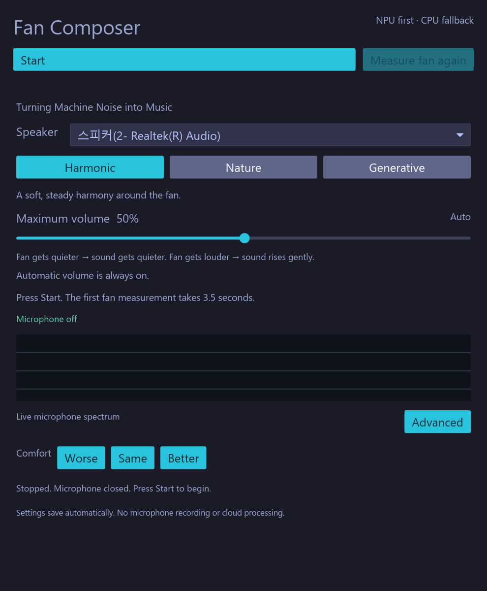

# Fan Composer

**Turning Machine Noise into Music**

A local, Rust-native Windows app that listens to laptop fan noise and adds a quiet, adaptive soundscape. Three synthesis modes, always-on automatic volume, and an NPU-first music policy with CPU fallback.

## Why this project exists

Fan Composer started because the Intel Core Ultra 7 laptop's NPU was rarely used in everyday work. It felt wasteful to leave that hardware idle, so the project grew from a search for a useful local application: using fan-noise characteristics to guide a continuous musical background.

The research question is whether this added sound can make fan noise less unpleasant. **This is not active noise cancellation.** Perceptual benefit and energy savings have not been established.

## Screenshot



Actual application capture. The stopped state keeps the microphone and playback off. Device names depend on the test machine.

## Download and use

Download **FanComposer-0.3.0-windows-x64.zip** from [Releases](https://github.com/zendoclab/fan-composer/releases).

1. Extract the **entire folder**, including `models/` and `runtime/`.
2. Run `fan-composer.exe`. Select the intended **Speaker**.
3. Set **Maximum volume** to a comfortable ceiling and press **Start**.
4. Wait for the initial **3.5-second quiet fan measurement**.
5. Try **Harmonic**, **Nature**, or **Generative**. Volume follows the estimated fan/background level automatically in all modes.
6. Press **Stop** at any time. **Measure fan again** deliberately pauses sound for another 3.5-second measurement.

Automatic volume is always on; there is no extra enable switch. It rises slowly, falls gently, and never exceeds the selected maximum gain or digital peak cap. Settings save automatically. FFT controls, microphone selection, synthetic fans, and detailed NPU diagnostics are under **Advanced**.

A speaker-reference profile is learned while playback continues. If the fan estimate is uncertain, the controller holds amplification or reduces playback. It does not blindly follow total microphone loudness. The estimate can include other steady ambient sounds and is not a fan/voice classifier or acoustic echo canceller.

[Detailed usage](docs/USAGE.md) · [Build guide](docs/BUILDING.md) · [Validation](docs/VALIDATION_EN.md) · [Architecture](docs/ARCHITECTURE.md)

## Three sound modes

| Mode | Sound |
|---|---|
| Harmonic | A continuous drone and overtones around a stable, octave-adjusted fan pitch |
| Nature | Mathematically synthesized wind/wave-like colored-noise textures |
| Generative | A seeded, stateful motif over an ambient background with slow changes |

No external music samples, cloud API, account, subscription, or microphone recording are required.

## NPU first, CPU fallback

The music-policy worker tries **OpenVINO NPU**, then **OpenVINO CPU**, then **CPU rules** when the model/runtime is unavailable. Enumeration, compilation, successful inference, and the actual execution device are checked separately. NPU/CPU decision counters and fallback reasons are visible in Advanced.

The model runs at **1 Hz** and controls brightness, density, overtones, motion, reverb, and stereo width. FFT, automatic volume, limiting, and sample synthesis run on the CPU. Rust calls the OpenVINO C API directly; Python is only an offline training/build tool.

The bundled 16→32→6 MLP imitates locally generated rules. It was not trained on listener comfort ratings and is not evidence that an NPU produces better music or saves power.

## Build from source

Windows 11 x64, Rust MSVC toolchain, Visual Studio C++ Build Tools and Windows SDK:

```powershell
git clone https://github.com/zendoclab/fan-composer.git
cd fan-composer
cargo build --release --locked
cargo test --release --locked
cargo clippy --all-targets --locked -- -D warnings
cargo fmt --all -- --check
```

The executable is `target/release/fan-composer.exe`. Without an OpenVINO runtime it uses the CPU rule fallback.

To enable the NPU runtime and create the portable package, install Python 3.11 x64 and Node.js, then run:

```powershell
python -m venv .venv
.venv\Scripts\python.exe -m pip install -r tools/requirements-openvino.txt
node tools/package.mjs
```

Run `dist/FanComposer/fan-composer.exe`. The committed model is ready to use; optional model regeneration:

```powershell
.venv\Scripts\python.exe tools/train_policy.py
```

See the [build guide](docs/BUILDING.md) for diagnostics and requirements. Copying only the EXE does not include the NPU runtime or model.

## Evidence and current limits

Recorded engineering checks include synthetic frequency tracking, safe synthesis, continuous playback, automatic-volume tracking, output-reference regressions, actual Windows device streams, and native NPU inference. The public validation report distinguishes controlled simulation, silent physical I/O, and informal listening feedback.

Version 0.3.0 passed **26 automated tests**. Its portable build performed **45 NPU policy decisions in 45 seconds of silent physical duplex I/O**, with input/reference drops 0, fault 0, callback over-budget 0, and one startup input Xrun. Maximum observed callback processing was 619 microseconds. These are bounded engineering observations, not proof of audible comfort or long-session stability.

Raw microphone/APO behavior, calibrated SPL, general speech separation, acoustic AEC, system loopback, tray operation, controlled listener studies, and 1-hour/8-hour endurance remain open work. Windows master volume and app-session volume are not changed by the app.

## Reproducibility and citation

The repository contains the Rust source, tests, fixed model, deterministic teacher-training script, English build/use documentation, and a sanitized public validation snapshot. Raw device inventories, local settings, machine-specific endpoint IDs, build directories, and credentials are excluded.

Author: **Kyu Lee**, **cording.ai**. See `CITATION.cff` and the preprint in the release.

## License

Source code and the locally generated policy model: **MIT**. The release's OpenVINO runtime and third-party components retain their own notices under `runtime/licenses/`. The preprint is **CC BY 4.0**.
